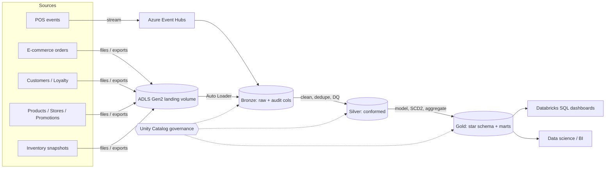
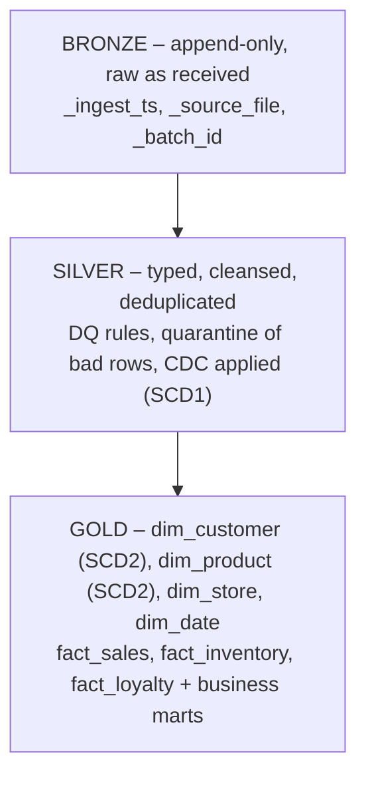
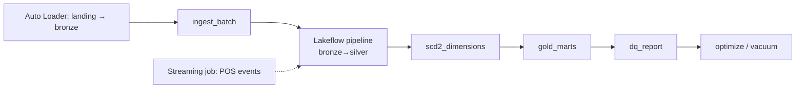
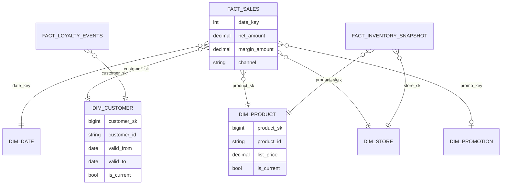
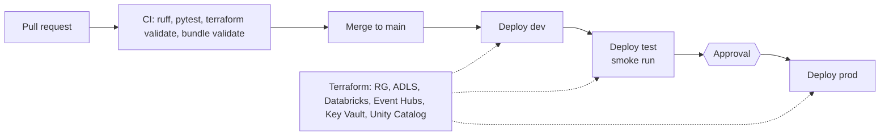

# Retail360 – Enterprise Retail Data Intelligence Platform

    

> A **fictional, independent portfolio project** with 100% synthetic data. It is not affiliated with any company.
> This repository is an **architecture showcase**: the design is complete, the implementation is partial (see [Status](#status)).

## 1. Business problem
A fictional retailer runs stores (POS), a web/app shop, a loyalty scheme and promotions, each with its own data. Teams cannot answer basic questions consistently: *What sold where? Who are our best customers? Which stock is at risk? Do promotions pay back?*

**Objective:** unify the data into one governed lakehouse and publish trusted, analytics-ready datasets.

## 2. Solution overview



## 3. Medallion architecture



| Layer | Purpose | Key techniques |
|---|---|---|
| Bronze | Land data unchanged | Auto Loader, schema evolution, rescued data column, Event Hubs (Kafka endpoint) |
| Silver | Trusted entities | Dedup by latest, `MERGE` for CDC (I/U/D, out-of-order safe), DQ expectations + quarantine, late-arriving handling |
| Gold | Business-ready | Star schema, SCD Type 2 dimensions, surrogate keys, aggregates |

## 4. Orchestration (Lakeflow)



* **Lakeflow Spark Declarative Pipeline** for bronze→silver with expectations.
* **Lakeflow Jobs:** `retail360_daily`, `retail360_streaming_pos` (continuous), `retail360_backfill` (date range).
* Retries, timeouts and alerts on every task; failed rows go to `ops.dq_quarantine`, runs to `ops.audit_log`.

## 5. Data model (Gold)



**Gold marts:** daily sales performance · store performance · product performance · customer 360 · customer lifetime value · inventory health · loyalty analytics.

## 6. CI/CD and infrastructure



Environments `dev` / `test` / `prod` use separate catalogs (`retail360_<env>`) and are deployed with **Declarative Automation Bundles**; infrastructure is **Terraform**; pipelines run in **Azure DevOps**.

## 7. Technology stack
Azure Databricks · PySpark · Delta Lake · Auto Loader · Structured Streaming + Event Hubs · Unity Catalog · Lakeflow Pipelines & Jobs · Declarative Automation Bundles · ADLS Gen2 · Azure DevOps (CI/CD) · Terraform · Pytest + Chispa · Databricks SQL.

## 8. Repository structure
```
Retail360/
├── src/retail360/        # config, common utils, data generator (core library planned: dq, transforms, ingestion)
├── infra/terraform/      # Azure + Databricks infrastructure (draft)
├── tests/                # unit tests; Spark tests marked spark_integration
├── docs/design-contract.md   # table names, columns, conventions
├── pyproject.toml
└── (planned) pipelines/ resources/ sql/ azure-pipelines/ databricks.yml
```

## 9. Status
| Area | State |
|---|---|
| Architecture and design contract | Done (this README, `docs/design-contract.md`) |
| Config, Spark helper, test fixtures | Done |
| Synthetic data generator, Terraform draft | Started, not verified |
| Silver/Gold code, Lakeflow files, bundle, CI/CD | Planned |

**Testing note:** unit tests are pure-Python/mock-based. Real Spark/Delta tests (`@pytest.mark.spark_integration`) need Linux, macOS, WSL or a container; run with `RETAIL360_RUN_SPARK_TESTS=1`.

## 10. Why this design
* **Medallion** separates raw, trusted and business layers, so reprocessing is cheap and lineage is clear.
* **Delta MERGE + SCD2** gives idempotent loads and full history.
* **Unity Catalog** centralises governance across environments.
* **Bundles + Terraform** make environments reproducible and reviewable.
